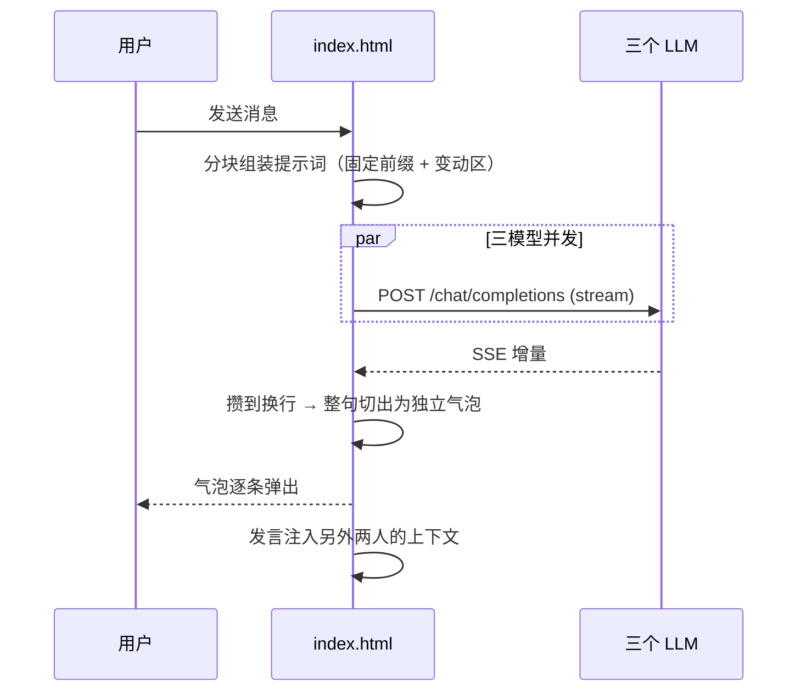

# 三人行 · Xiaojia

> **三个大模型，一个群聊。**
> 多智能体并发的 AI 群聊应用：三个模型同时响应、互相可见、自主接梗。67 条场景梗（每条人工标注关键词）、21 张人设牌，138KB 纯前端单文件实现，无框架、无构建、无后端。

🔗 **在线演示**：https://xm331.github.io/xiaojia/


---

## 这个项目解决什么

现有 AI 对话产品的交互都是单线程的：一个模型、一种语气、一问一答。而这个项目让**三个模型在同一个会话里并发响应、互相读取对方的发言**，行为更接近真实的群聊：

- **并发不排队**：三个请求同时发出，谁先返回谁先渲染
- **互相可见**：任一发言真正播出后写入一份共享群流水（带说话人），另两人读取时过滤掉自己那条；接龙场景改传「最后一句 + 本轮已说过」，因此接话是真接话，不是各自背诵
- **梗库驱动但绝不硬塞**：每条梗人工标注 2~5 个口语关键词，只有这句话命中关键词才会成为候选（最多 3 条）；一条都不沾就一条都不给，宁可这轮不玩梗
- **人设牌系统**：21 张权重对等的人设卡随机抽取，同一个模型在不同轮次表现出不同说话风格
- **头像可换**：点击自己的头像上传本地图片，前端 canvas 压缩到 128×128 后仅存在设备本地

---

## 五个核心技术问题

### 1. 多模型并发编排与上下文注入

三个角色是三次独立的 API 请求，`Promise.all` 并发发出，各自渲染各自的流式响应。难点在于"并发"与"互相看见"是矛盾的——共享上下文会让三个模型说一样的话，完全隔离则无法接话。

解法：每个角色持有独立历史；任一发言**真正播到屏幕上之后**写入一份共享群流水（带说话人），请求时注入并过滤掉自己那条。模型由此产生真实的回应关系（附和、反驳、抢话），而非轮流输出。

### 2. 分段流式渲染：整句弹出而非逐字打字

逐字打字机是 AI 产品的通病——真实的消息是"想好一句发一句"。本项目基于 SSE 实现分段流：**缓冲区遇到换行即把该完整行作为独立气泡弹出**，句间保留 200~380ms 间隔；半句绝不提前渲染：

```js
const lines = full.split("\n");
const doneLines = /\n\s*$/.test(full) ? lines.length : lines.length - 1;
```

长段落（持续不换行）退回逐字模式，避免长回复场景下的长时间空白。

### 3. 提示词分块与前缀缓存优化

初版将所有规则揉成一段 340 字的系统提示词，任何场景全量下发，且包含互相冲突的指令（"玩梗要短"与"认真要长"并存）。

重构为分层结构，并重排消息顺序以命中供应商的上下文缓存：

```
人设卡 → 核心规矩(202字) → 场景规则(闲聊/玩梗/认真/关心 四选一) → 表情规则 → 记忆
                    ↑ 固定前缀，顺序稳定                    ↑ 每轮变化的部分统一后置
```

固定前缀稳定后，供应商的 KV 缓存可以复用，预填充计算量大幅下降。**实测单轮输入 3265 字 → 2140 字（-34%）**，同时消除了矛盾指令导致的输出风格漂移。

### 5. 两种说话模式，硬冲突

"三个人同时想、谁快谁说"和"接龙必须按顺序"是互斥的。

队形台词（例如「你只是怕了」→「这谁不怕」）是前端写死的字符串，毫秒级就能入队；而要接的那句起头得等模型，一两秒。两者混在同一个并发里跑，必然出现后面两句抢在前面——屏幕上蹦出「你只是怕了」，它要接的那句还没影。

解法：按"这一轮有没有队形"分成两条物理隔离的通道。

```js
const formation = !!(userLead || chainLeads.length);   // 有队形 = 接龙
```

- **有队形**：严格串行。起头 → 台词 0 → 台词 1 → 自由人，每句 `await` 到**真正播完**才轮到下一句。
- **没有队形**：三人同一瞬间发请求，谁先想好谁先说，不排座次。

关键细节：串行判断只认"**屏幕上真正播出去的**"（渲染函数里写入的 `played` 记录），而不是"谁生成了什么"。否则模型会去接一句还躺在队列里、根本没出声的话。

### 4. 移动端密钥持久化

移动浏览器切后台即杀进程，localStorage 可能被清空。采用四级降级：

```
localStorage（主）→ localStorage（备份项）→ cookie → IndexedDB
```

任一层捞回钥匙后自动补齐其余各层，下次更不容易丢。

配合 `navigator.storage.persist()` 申请持久化配额。密钥**不进 URL、不进代码、不上传**——分享链接不会泄露任何人的 API 额度。

---

## 架构



### 三层记忆

| 层 | 内容 | 上限 | 生命周期 |
|---|---|---|---|
| 长期事实 | 用户主动陈述的稳定个人信息 | 600 字 | 永久，压缩去重 |
| 共享记忆 | 三角色共用的人物档案 | 1500 字 | 长期，超长自动整理 |
| 最近对话 | 每角色最近 10 条上下文 | — | 滚动淘汰 |

记忆**按场景分级下发**：玩梗场景只携带身份识别所需的最小片段，认真对话/私聊才下发全量——既减少约 1100 字输入，也避免闲聊场景翻旧账。

---

## 快速开始

```bash
git clone <this-repo>
cd xiaojia
python3 -m http.server 8080
```

访问 `http://localhost:8080`（需 http 协议，Service Worker 才能注册）。

首次打开填入 API Key（`sk-` 开头）：

- 默认对接 [硅基流动](https://siliconflow.cn)，兼容任何 **OpenAI 格式**接口
- 更换供应商：修改 `PROVIDERS` 与 `MODEL_FAST` / `MODEL_HEART`
- 密钥仅存于当前设备浏览器

### 部署

GitHub Pages：Settings → Pages → Deploy from a branch → `main` / `(root)`。
HTTPS 环境下自动启用 Service Worker，可安装为 PWA。

---

## 技术栈

`原生 JavaScript` · `CSS` · `SSE 流式` · `Service Worker` · `PWA` · `OpenAI 兼容 API`

无框架、无构建工具、无 node_modules——**修改一行即可上线，fork 后双击即可运行，不存在依赖失效风险**。

---

## 目录结构

```
.
├── index.html            # 全部代码（HTML + CSS + JS，约 1900 行）
├── manifest.webmanifest  # PWA 清单
├── sw.js                 # Service Worker：离线缓存与资源补码
├── icon.png / home.jpg   # 应用图标 / 群头像
├── *_bust2.webp          # 三个角色头像
├── emojis/               # 内置表情包
└── tests/                # 测试（无需浏览器，假 DOM + 假接口）
```

---

## 怎么验证它真的能跑

不带浏览器、不连模型，直接跑：

```bash
node tests/run-all.js
```

| 测试 | 验什么 |
|---|---|
| `smoke.js` | 整页脚本能否在无浏览器环境执行完、有没有 `console.error` |
| `stream-queue.js` | 三人发言队列：同轮撞句丢弃、复读牌豁免、空回复不卡死、慢的人不拖住全场 |
| `key-store.js` | 钥匙只存在本机、不会串用别人的额度（六种存储状态） |
| `lead-chain.js` | 用户起头时 AI 接固定台词、顺序正确、第三人让位 |
| `reply-length.js` | 长句自动拆条、被截断时不留半句 |
| `memes.js` | 梗库加载与 `{U}` 占位替换 |
| `rate-limit.js` | 429 短时限流要重试、真配额耗尽直接报 |
| `context-shape.js` | 提示词结构：表情包按需给、缓存前缀顺序、群聊流水归属 |

这些不是摆设。项目里几个真 bug 就是它们抓出来的：流式回调漏传（导致整段说完才开始显示）、队列死锁（一人被打断全场卡住）、延迟设在错误对象上（顺序仍然错）。**改完代码跑一遍，比肉眼读一遍可靠。**

---

## 踩坑实录

开发过程踩过并修掉的坑——流式回调漏传、超时一刀切误杀、接龙抢跑、随机补梗、钥匙提醒永久静音、SW `const` 重赋值、preconnect 不带 crossorigin——每一坑都有「现象 → 排查 → 根因 → 修复 → 教训」的完整记录，见 [docs/DEVLOG.md](docs/DEVLOG.md)。

---

## 已知取舍

- **单文件不是可持续的架构**，但让"分享即使用"成立——把使用的门槛压到了最低。长期维护应拆分模块。
- **无后端**，因此没有多用户与跨设备漫游，数据归属当前设备。
- **情绪判定为关键词启发式**，存在误判空间。
- **模型是外部依赖**，供应商下线模型将直接 403（踩过两次，现换模型前先核对官方公告）。

---

## License

MIT
